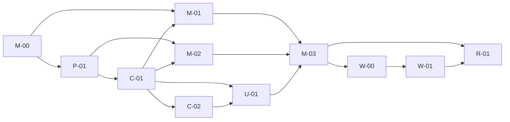

# Delivery and remaining issues

Local planning IDs only: no GitHub repository/Issues were created.

| ID | Deliverable | Dependency | Current acceptance |
|---|---|---|---|
| M-00 | Public API probe and wired reference evidence | — | USB metadata and local tap sample observed; global vocabulary not verified |
| P-01 | Hardware/API/language/license/distribution ADR | M-00 | Swift/public-only experiment chosen; license/distribution pending |
| C-01 | Strict versioned input/config contract | P-01 | Implemented with tests; see validation |
| C-02 | Deterministic core, replay, seeded fuzz | C-01 | Synthetic and saved local tap replay; hardware false-trigger validation pending |
| M-01 | Capture, permissions, lifecycle | M-00,C-01 | Experimental local view + discovery; global USB adapter blocked on evidence |
| M-02 | Safe actions, onboarding | P-01,C-01 | Manual handler actions; key injection unsupported |
| U-01 | Gesture editor, visualizer, conflicts, import/export | C-01,C-02 | Local implementation; source limitations visible |
| M-03 | Build, package, whole-product checks | M-01,M-02,U-01 | Local simulation build; full device/distribution acceptance open |
| W-00 | Windows 11 x64 wired feasibility | M-03 | Future; no implementation |
| W-01 | Windows adapter | W-00 | Future |
| R-01 | macOS/Windows Bluetooth | M-03,W-01 | Future |

Independent schema/core/editor work proceeds despite missing hardware; this does not close M-00. Next priorities: wired reference capture, global API/distribution choice if needed, false-trigger/lifecycle hardware matrix, safe keyboard design proof, signed distribution only after explicit approval.

## Locally registered follow-up

- Packaging backup discoverability: retained `previous.app` bundles share the app identifier and made bundle-ID lookup ambiguous on 2026-09-12. Selecting the explicit current `dist/TrackpadGestures.app` path resolved this run. Future packaging work should retain rollback evidence in a form that is not another discoverable application; do not delete old generated output merely to fix lookup. This is registered only, with no packaging change in the physical-contact confirmation task.

- Preview-expiry message after export: the UI can say “No raw stream was saved” after an explicit sample export has succeeded. The 2026-09-13 file was independently verified on disk. A future wording fix should distinguish no automatic logging from a successfully exported sample; this confirmation task only records the finding.

- Manual Hide action observation: on 2026-09-13 the UI reported unavailable for Finder while a subsequent read-only process query found it hidden. Pre-call state was not recorded, so causality is unknown. When continuing M-02, distinguish already-hidden targets from failed hide transitions with a controllable backend test and OS readback; preserve any user-held state. No broad action-execution change was made during the capture-validation follow-up.

- M-00 follow-up: operator confirmed Finder operations; zero CLI counts remain unexplained. The visible GUI diagnostic supplies a directly started window and frozen auto-save. Positive physical pointer receipt, correct GUI permission context and then global gesture fields remain prerequisites; do not promote support based on an idle timer or registration success.
- M-03 performance evidence: coarse GUI process CPU around 10% / RSS around 96 MiB is not an acceptance measurement. Profile idle versus diagnostic-active CPU and sustained memory with a verified physical input control before release claims.
